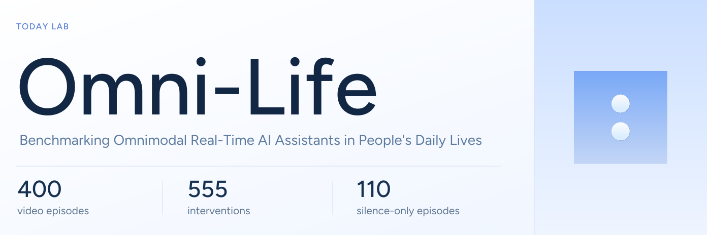
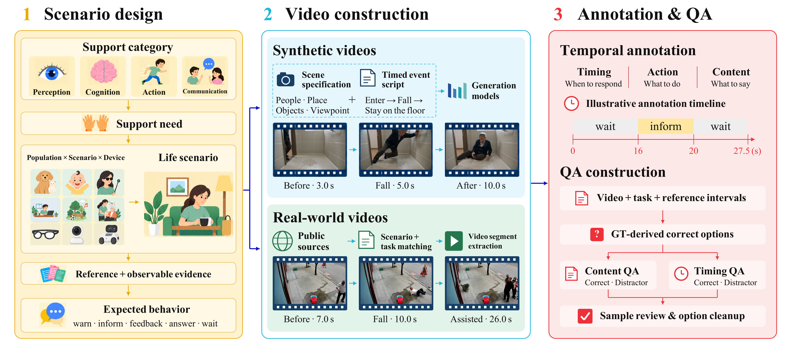

<p align="center">
  <picture>
    <source media="(max-width: 600px)" srcset="assets/readme/hero-mobile.svg" />
    
  </picture>
</p>

<p align="center"><a href="https://todayai-labs.github.io/omni-life/">Project page</a> &nbsp;·&nbsp; <a href="https://arxiv.org/html/2611.02835v1">Read the paper</a></p>

https://github.com/user-attachments/assets/564c1b7b-8b76-41b6-8c7c-f63fdf7bb6bf

## The benchmark

Omni-Life tests whether real-time omnimodal assistants can **provide useful help at the right moment and stay silent when help is unnecessary**. It spans **5 everyday scenarios and 12 service groups**, combining controlled synthetic videos and real-world footage under one temporal protocol.

<a href="assets/readme/benchmark-pipeline.png"></a>

## Dataset and evaluation

- **Sources:** 277 synthetic and 123 real-world videos.
- **Streaming:** 290 assistance episodes with 555 interventions, plus 110 fully silent episodes. The five actions are `inform`, `warn`, `feedback`, `answer`, and `wait`.
- **QA:** 800 questions, split equally between content and timing; Joint QA requires both answers for an episode to be correct.
- **Reproduction:** `--check` verifies metrics and every case-level match at 0 / 1 / 2 / 5 / 10-second end-window tolerances.
- **Timing:** source-media timestamps track receipt of the first text content, not audible playback. Content judgments, temporal eligibility, and one-to-one matching are separate stages.


## Examples

<a href="assets/readme/dataset-examples.png?v=135e34de7abb">
  <picture>
    <source media="(max-width: 600px)" srcset="assets/readme/dataset-examples-mobile.png?v=135e34de7abb" />
    
  </picture>
</a>

## Quick start

Reproduce the released **MiniCPM-o 4.5** reference scores with **Python 3.10+**. No additional packages, videos, GPU, or API calls are needed.

```bash
git clone https://github.com/todayai-labs/omni-life.git
cd omni-life
python3 -m evaluation validate
python3 -m evaluation score --check
```

This release includes annotations, prompts, evaluation tools, and frozen reference results. **Source videos are not included due to their large size. Access may be provided upon reasonable request, subject to source-specific rights and privacy review.**

[Run a new evaluation](evaluation/README.md#run-a-new-evaluation) · [Dataset card](dataset/README.md) · [Reference results](results/README.md)

Evaluation tools are in [`evaluation/`](evaluation/README.md); annotations and questions are in [`dataset/`](dataset/README.md).

<details>
<summary><strong>Released reference scores</strong></summary>

MiniCPM-o 4.5, with the original response windows:

| Recall ↑ | Event F1 ↑ | Full Correct ↑ | Silence Success ↑ | Unwanted / min ↓ |
|---:|---:|---:|---:|---:|
| 1.44% | 2.63% | 1.38% | 95.45% | 0.14 |

| Content QA ↑ | Timing QA ↑ | Joint QA ↑ |
|---:|---:|---:|
| 53.50% | 25.75% | 13.00% |

Full Correct uses 290 assistance episodes; Silence Success uses 110 fully silent episodes. Failed sessions remain in the fixed denominators.

</details>

## License and data access

**Code:** [Apache-2.0](LICENSE). **Benchmark data:** [non-commercial research evaluation only](dataset/LICENSE); model training is prohibited.

For data requests, contact [mengze@today.ai](mailto:mengze@today.ai) and follow the [access and privacy process](dataset/README.md#access-privacy-and-rights).

<p align="center"><sub><a href="https://today.ai">Today</a> &nbsp;·&nbsp; Omni-Life</sub></p>
