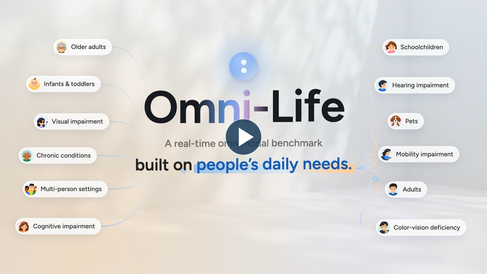

<p align="center">
  <picture>
    <source media="(max-width: 600px)" srcset="assets/readme/hero-mobile.svg" />
    
  </picture>
</p>

<p align="center"><a href="https://todayai-labs.github.io/omni-life/">Project page</a> &nbsp;·&nbsp; <a href="https://arxiv.org/html/2611.02835v1">Read the paper</a> &nbsp;·&nbsp; <a href="https://huggingface.co/datasets/mengze-hong/omni-life">Hugging Face dataset</a> &nbsp;·&nbsp; <a href="results/README.md">Results</a></p>

<p align="center">
  <a href="https://todayai-labs.github.io/omni-life/media/overview.mp4">
    
  </a>
</p>
<p align="center"><a href="https://todayai-labs.github.io/omni-life/media/overview.mp4">Watch the overview</a> &nbsp;·&nbsp; <a href="https://github.com/todayai-labs/omni-life/raw/refs/heads/main/assets/readme/omni-life-promo.mp4">Download MP4</a></p>

## The benchmark

Omni-Life tests whether real-time omnimodal assistants can **provide useful help at the right moment and stay silent when help is unnecessary**. It spans **5 everyday scenarios and 12 service groups**, combining controlled synthetic videos and real-world footage under one temporal protocol.

<a href="assets/readme/benchmark-pipeline.png"></a>

## Dataset and evaluation

- **Sources:** 277 synthetic and 123 real-world videos.
- **Streaming:** 297 assistance episodes contain 500 required interventions, including 13 final counts. Another 103 episodes require silence.
- **QA:** 400 Content questions and 400 Timing questions. Joint QA checks both answers for each episode.

Download the [dataset and media](https://huggingface.co/datasets/mengze-hong/omni-life) and browse the 11-model [main results](results/summary.csv) and [ablations](results/ablations.csv). Streaming uses scene-level **Full Correct** across 400 scenes. A scene passes when every required response is correct and on time, with no extra responses.

## Examples

<a href="assets/readme/dataset-examples.png?v=135e34de7abb">
  <picture>
    <source media="(max-width: 600px)" srcset="assets/readme/dataset-examples-mobile.png?v=135e34de7abb" />
    
  </picture>
</a>

## Quick start

Verify the published results with Python 3.10+ and the Hugging Face CLI. The command downloads only the files needed for scoring.

```sh
git clone https://github.com/todayai-labs/omni-life.git
cd omni-life
python3 -m pip install huggingface_hub
hf download mengze-hong/omni-life --repo-type dataset \
  --revision 5f776e25cb1f1eb51b42bc2ddf82eab795544755 \
  --include 'scenes.csv' --include 'qa/*' --include 'protocol/streaming-scoring.json' \
  --local-dir ./omni-life-data
python3 -m evaluation reproduce --dataset ./omni-life-data --check
```

[Evaluation guide](evaluation/README.md) · [Per-model records](results/README.md) · [Dataset and media verification](evaluation/README.md#verify-the-dataset)

## Citation

Use the [paper’s BibTeX entry](https://huggingface.co/datasets/mengze-hong/omni-life#citation) when citing Omni-Life.

## License

Evaluation code uses [Apache-2.0](LICENSE). The [Hugging Face dataset card](https://huggingface.co/datasets/mengze-hong/omni-life#access-privacy-and-rights) gives the terms for data, media and benchmark results.

<p align="center"><sub><a href="https://today.ai">Today</a> &nbsp;·&nbsp; Omni-Life</sub></p>
