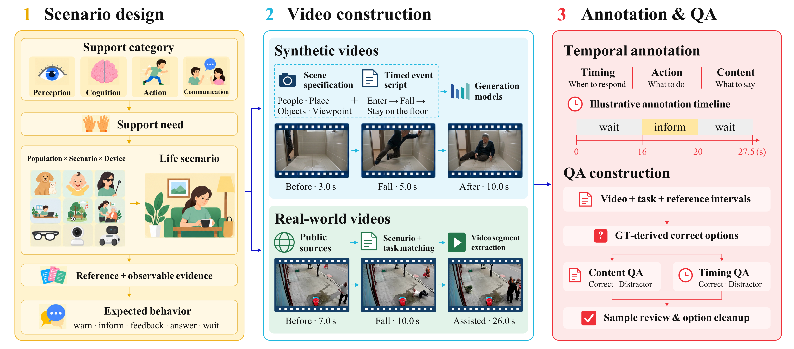

<p align="center">
  <picture>
    <source media="(max-width: 600px)" srcset="assets/readme/hero-mobile.svg" />
    
  </picture>
</p>

<p align="center"><a href="https://todayai-labs.github.io/omni-life/">Project page</a> &nbsp;·&nbsp; <a href="https://arxiv.org/html/2611.02835v1">Read the paper</a> &nbsp;·&nbsp; <a href="https://huggingface.co/datasets/mengze-hong/omni-life">Hugging Face dataset</a></p>

https://github.com/user-attachments/assets/564c1b7b-8b76-41b6-8c7c-f63fdf7bb6bf

## The benchmark

Omni-Life tests whether real-time omnimodal assistants can **provide useful help at the right moment and stay silent when help is unnecessary**. It spans **5 everyday scenarios and 12 service groups**, combining controlled synthetic videos and real-world footage under one temporal protocol.

<a href="assets/readme/benchmark-pipeline.png"></a>

## Dataset and evaluation

- **Sources:** 277 synthetic and 123 real-world videos.
- **Streaming:** 297 assistance episodes contain 500 required interventions, including 13 final counts. Another 103 episodes require silence.
- **QA:** 400 Content questions and 400 Timing questions. Joint QA checks both answers for each episode.

Download the data, media and scoring rules from [Hugging Face](https://huggingface.co/datasets/mengze-hong/omni-life).

## Examples

<a href="assets/readme/dataset-examples.png?v=135e34de7abb">
  <picture>
    <source media="(max-width: 600px)" srcset="assets/readme/dataset-examples-mobile.png?v=135e34de7abb" />
    
  </picture>
</a>

## Quick start

From the repository root, verify the model results with Python 3.10+ and the Hugging Face CLI.

```sh
hf download mengze-hong/omni-life --repo-type dataset \
  --include 'scenes.csv' 'qa/*' 'protocol/streaming-scoring.json' \
  --local-dir ./omni-life-data
python3 -m evaluation reproduce --dataset ./omni-life-data --check
```

[Evaluation commands](evaluation/README.md) · [Model results](results/README.md) · [Hugging Face dataset](https://huggingface.co/datasets/mengze-hong/omni-life)

## License

Evaluation code uses [Apache-2.0](LICENSE). The [Hugging Face dataset card](https://huggingface.co/datasets/mengze-hong/omni-life#access-privacy-and-rights) gives the terms for data, media and benchmark results.

<p align="center"><sub><a href="https://today.ai">Today</a> &nbsp;·&nbsp; Omni-Life</sub></p>
